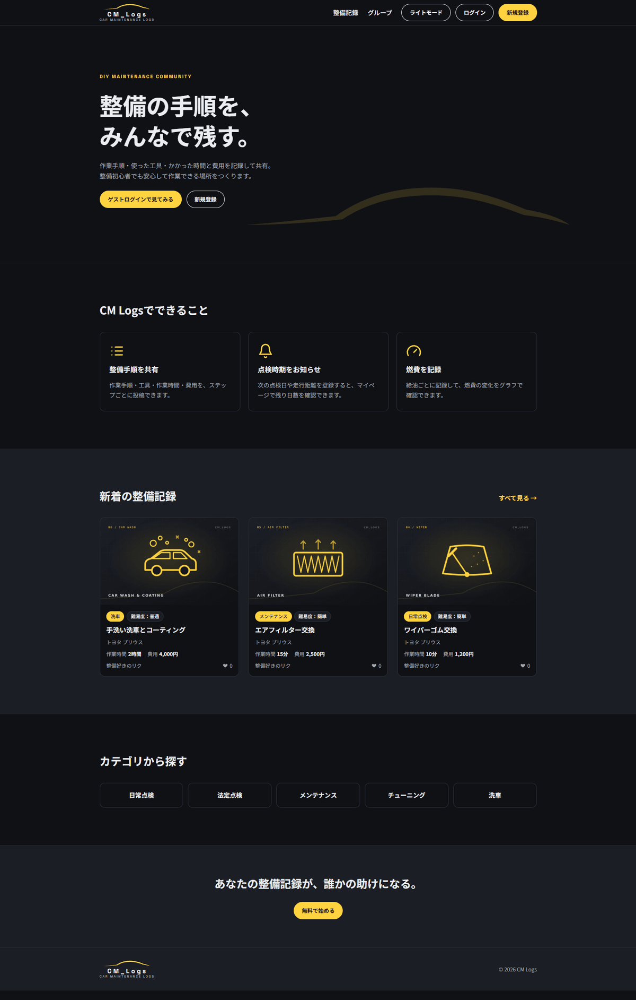
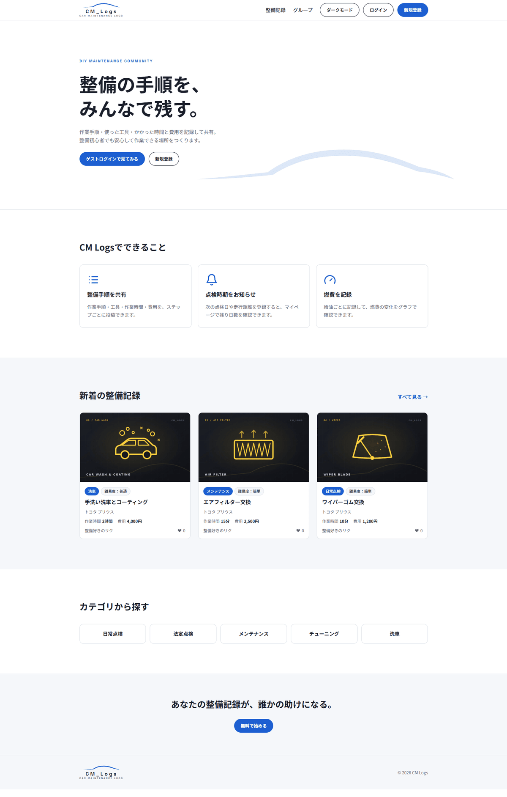
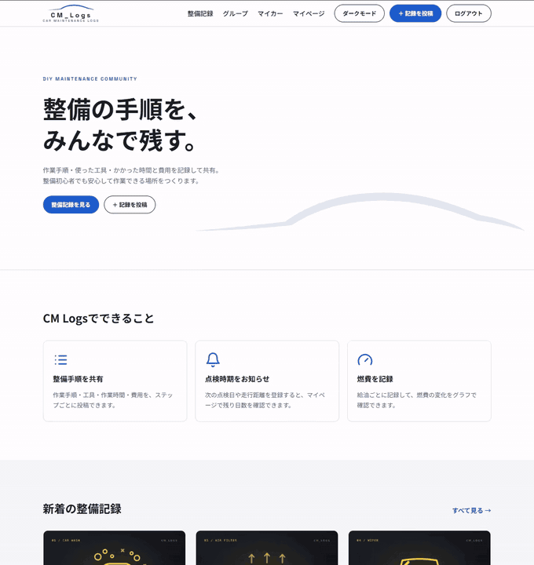
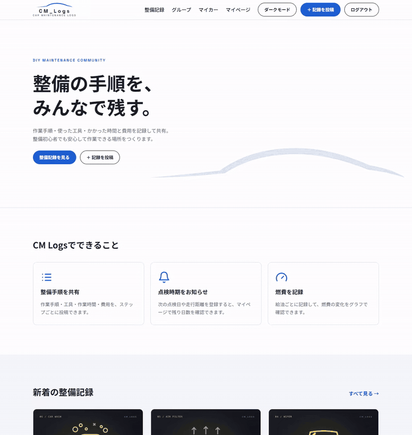
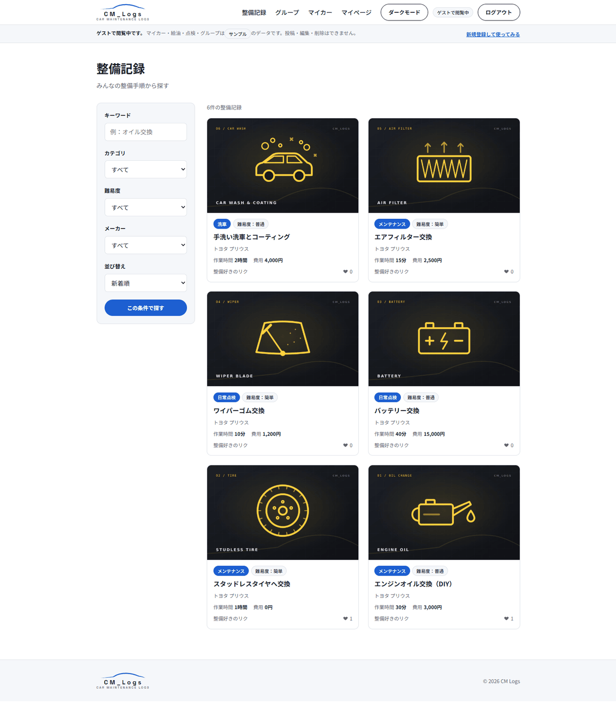
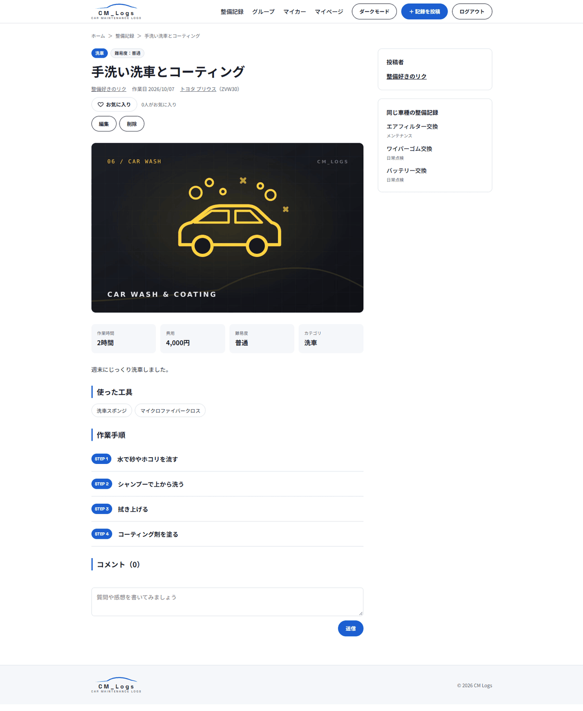
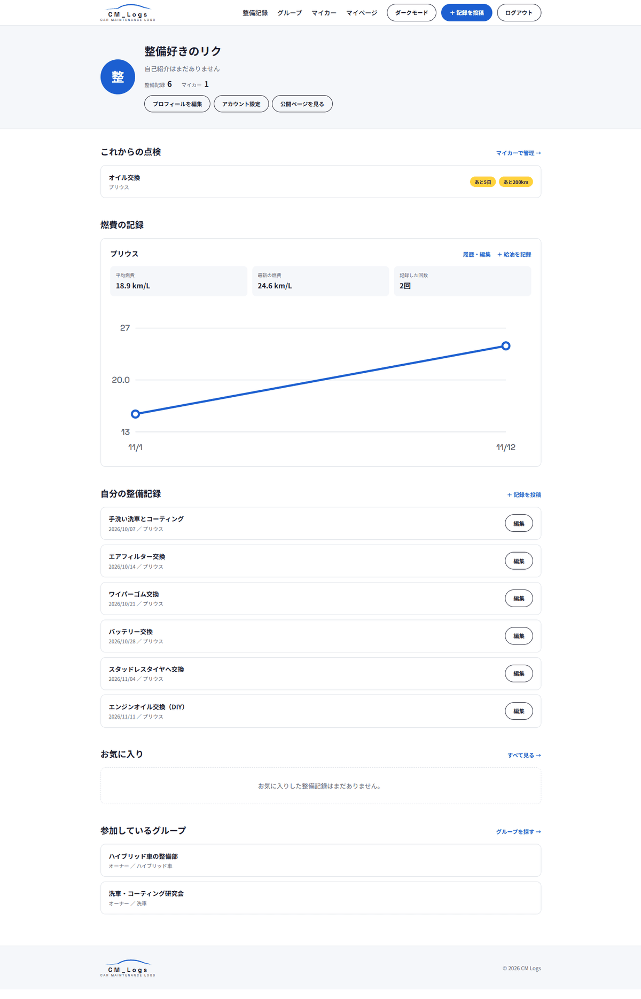
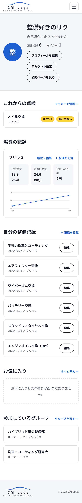
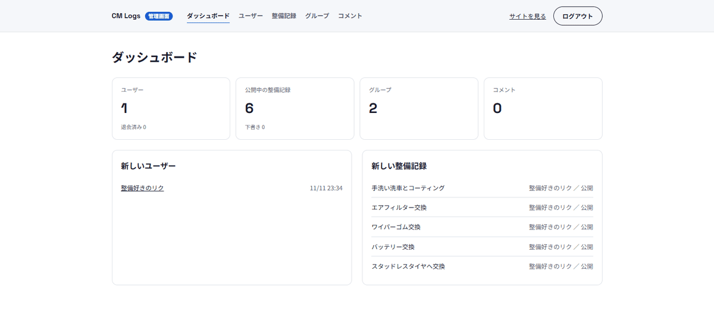
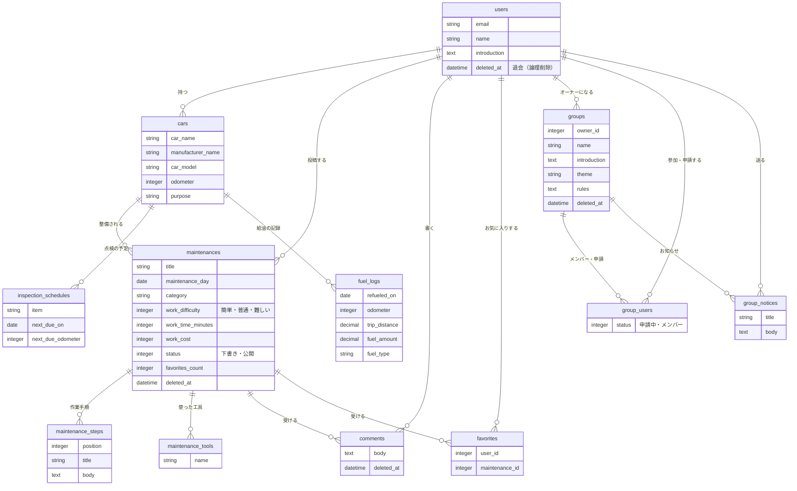

# CM Logs（Car Maintenance Logs）

車の整備手順を投稿・共有し、点検時期や燃費も管理できるコミュニティサイトです。
以前Rails 6で作った「CM_Logs」を、**Rails 8.1で一から作り直しました**。

**URL：** ※ 本番公開はしていません。下のスクリーンショットか、「[ローカルでの起動方法](#ローカルでの起動方法)」の手順で確認してください。

> トップページの「**ゲストログインで見てみる**」から、登録なしで中を見られます。
> ゲストにはマイカー・燃費・点検・グループのサンプルデータを入れてあります（閲覧のみ）。

## スクリーンショット

### トップページ（ダーク／ライト）

| ダークモード | ライトモード |
|---|---|
|  |  |

### ダーク／ライトの切り替え



### 整備記録の投稿（作業手順をその場で追加）



### 整備記録の一覧・詳細

| 一覧（検索・絞り込み・並び替え） | 詳細（作業手順・使った工具） |
|---|---|
|  |  |

### マイページ（点検のお知らせ・燃費グラフ）

| PC | スマホ |
|---|---|
|  |  |

### 管理画面



---

## サイト概要

### サイトテーマ

車のメンテナンス手順を投稿したり、メンテナンス時期の通知や、使用した工具の情報を投稿・確認できるコミュニティサイト

### テーマを選んだ理由

自分が学生の頃、整備に取り組もうとした際に必要な工具や手順、メンテナンスの時期を忘れてしまって、余計な出費をしてしまった経験がありました。
こうした情報が一か所で整理されていれば、初心者でも安心して整備に取り組めるのではないかと感じています。
そのため、初めて整備を行う人にとって分かりやすく、またメンテナンス時期も知らせることで、実践的かつ継続的にサポートできる仕組みを作りたいと考え、このテーマを選びました。

### ターゲットユーザー

- これから整備を始めようとする人
- 整備を学ぶ学生や初心者
- メンテナンス時期をよく忘れてしまう人、時期がよく分からない人
- 作業手順が分からない人、自信がない人
- どの工具を使えばいいか分からない人

### 主な利用シーン

- メンテナンス時期を忘れてしまったとき
- メンテナンスの手順や金額、作業時間を知りたいとき
- 自分が整備したときの手順や感想を残したいとき

---

## 機能一覧

### 整備記録

- 投稿・編集・削除、下書き保存
- 作業手順（STEP 1, 2, 3…）と使った工具を、ボタンで欄を増やしながら入力
- キーワード検索、カテゴリ・難易度・メーカーでの絞り込み
- 並び替え（新着順・人気順・**費用が安い順・作業時間が短い順**）
- コメント、お気に入り（ページを再読み込みせずに反映）
- 同じ車種の整備記録の表示

### マイカー・マイページ

- 車の登録（複数台）
- 点検の予定（日付・走行距離のどちらでも登録できる）と、残り日数・残り距離のお知らせ表示
- 給油の記録と、**燃費の折れ線グラフ**・平均燃費
- 自分の整備記録（下書き含む）、お気に入り、参加中のグループの一覧

### ユーザー・グループ

- プロフィール編集（名前・自己紹介・画像）、ユーザーごとの公開ページ
- グループの作成・編集・削除、参加申請 → オーナーが承認、メンバーの削除・退出
- オーナーからメンバーへのお知らせ（メール送信）

### アカウント・その他

- 新規登録・ログイン（Devise）、ゲストログイン（閲覧のみ）
- 退会（論理削除）
- ダークモード／ライトモードの切り替え
- スマホ・タブレット・PCに対応したレスポンシブデザイン

### 管理画面（`/admin`）

- 管理者用のログイン（一般ユーザーとは別のアカウント）
- ダッシュボード（ユーザー数・投稿数など）
- ユーザー・整備記録・グループ・コメントの一覧と検索、削除・復元

---

## 作り直しで改善したこと

### 1. 費用・作業時間で並び替えられるようにした

- **旧）** 費用・作業時間を文字で保存していたため、安い順・短い順に並べられなかった
- **新）** **数値型**で保存し、「費用が安い順」「作業時間が短い順」で並び替えられるようにした

### 2. 作業手順と工具を、別々のテーブルに分けた

- **旧）** 使った工具は1つの文字の欄に、作業手順はJSONで1つの列にまとめて保存していた
- **新）** 手順と工具を**それぞれ別のテーブル**にし、手順には並び順を持たせた。入力欄はボタンで増やしたり減らしたりできる（Stimulus）

### 3. コメント・お気に入りを、ページを読み直さずに反映

- **旧）** ページ全体を読み直して反映していた
- **新）** **Turbo Stream**で、その部分だけをその場で書き換える

### 4. 燃費をグラフで見られるようにした

- **旧）** 燃費は数字の表示のみ
- **新）** Rubyで座標を計算し、**SVGで折れ線グラフ**を自作（外部ライブラリなし）

---

## 工夫した点

- **ゲスト用のサンプルデータ**：ゲストにもマイカー・給油・点検・グループの見本データを用意し、登録しなくても点検のお知らせや燃費グラフを見てもらえるようにしました。見本には「サンプル」の印をつけ、編集・削除のボタンは出しません
- **燃費グラフを外部ライブラリなしで実装**：線や点の色をCSSの変数で指定しているため、ダーク／ライトの切り替えに自動で追従します。グラフの内容は、読み上げソフト向けに表でも出しています
- **平均燃費の計算**：毎回の燃費の平均ではなく「合計の走行距離 ÷ 合計の給油量」で計算し、給油量が少ない回に引っぱられないようにしました
- **N+1問題の対策**：`includes` でまとめて読み込み、お気に入りの数はカウンターキャッシュ（`favorites_count`）で持っています
- **他人のデータを触れない作り**：編集・削除は必ず `current_user` の持ち物の中から探すので、URLの番号を書き換えても他人のデータは操作できません
- **二重登録の防止**：お気に入りとグループの参加は、モデルのチェックに加えて、データベースのユニーク制約でも止めています
- **グループのお知らせメール**：メンバー1人に1通ずつ送り、ほかのメンバーのメールアドレスが見えないようにしています
- **アクセシビリティ**：見出しの構造、`aria-label`・`aria-pressed`、キーボードで操作できるボタン、色だけに頼らない表示を意識しました

---

## 使用技術

| 分類 | 技術 |
|---|---|
| 言語 | Ruby 3.4.12 / HTML / SCSS / JavaScript |
| フレームワーク | Ruby on Rails 8.1 |
| フロントエンド | Hotwire（Turbo・Stimulus）、importmap、Dart Sass |
| データベース | SQLite |
| 認証 | Devise（devise-i18n で日本語化） |
| 画像 | Active Storage |
| メール | Action Mailer、Active Job（開発中は letter_opener_web で確認） |
| CSS設計 | FLOCSS（`l-` レイアウト / `c-` コンポーネント / `p-` ページ / `u-` ユーティリティ） |
| 開発環境 | Ubuntu 24.04（WSL2）、VS Code |

---

## ER図



管理者（`admins`）は、一般ユーザーとは別のテーブルです。

---

## ローカルでの起動方法

必要なもの：Ruby 3.4.12 / SQLite3 / libvips（画像処理用）

```bash
git clone https://github.com/Murata397/cm_logs_v2.git
cd cm_logs_v2
bundle install
bin/rails db:prepare
bin/rails db:seed
bin/dev
```

http://localhost:3000 を開きます。

### 動作確認用のアカウント（開発環境のみ）

| 種類 | ログイン方法 |
|---|---|
| ゲスト | トップページの「ゲストログインで見てみる」 |
| 一般ユーザー（サンプル投稿あり） | `demo@example.com` / `password` |
| 管理者 | http://localhost:3000/admin/sign_in から `admin@example.com` / `password` |

本番環境では、管理者のアカウントを環境変数 `ADMIN_EMAIL`・`ADMIN_PASSWORD` で設定します（設定しないと `db:seed` がエラーで止まります）。

### 開発中に送ったメールの確認

http://localhost:3000/letter_opener で、送信したメールの中身を確認できます（実際には送信されません）。

---

## 設計書（旧CM_Logs）

- ER図：https://drive.google.com/file/d/1pQRFQn2vDjx4hhMxxo_8Pd0U95pmREH4/view?usp=sharing
- 画面設計：https://drive.google.com/file/d/1tTyo9iXE6EEcuqB-Zc3SzqPgZ7ZrcEvy/view?usp=sharing
- テーブル定義書：https://docs.google.com/spreadsheets/d/1bYKUt_3xFuddmjszMtLODFeMQEdzCWOZguCdi6wEWyA/edit?usp=sharing
- アプリケーション詳細設計書：https://docs.google.com/spreadsheets/d/1AaOre6iF-UHjTLSwOZzPSXIr_Tgep6HO8VIzRqoKiWY/edit?usp=sharing
